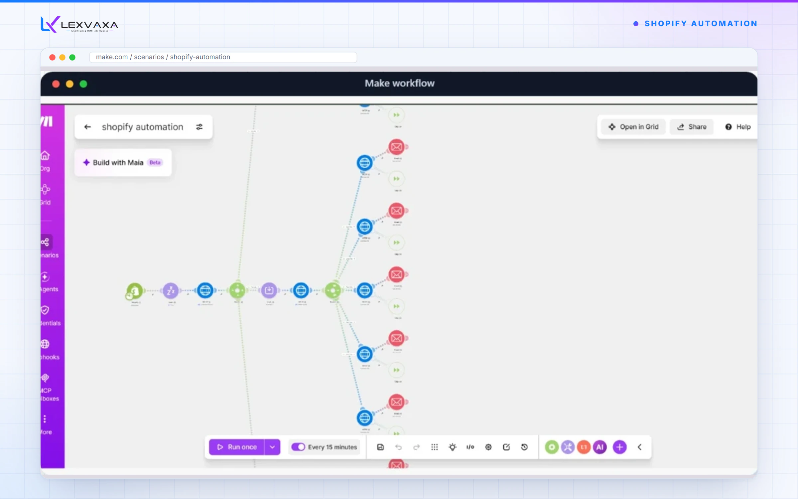

# Shopify E-commerce Workflow Automation

**A Make automation that handles repetitive Shopify tasks with smart routing, conditional logic and scheduled runs, so the store needs fewer manual checks.**

     

## Overview

An e-commerce store spent time on repetitive Shopify tasks that needed manual checks. Lexvaxa built a Shopify workflow automation in Make that connects to the store through HTTP and API requests, routes every case through conditional branches, sends the right emails automatically and runs on a schedule. Screens shown use sample data, so no client records are exposed.

## The challenge

Store staff checked and handled routine Shopify cases by hand every day.

## The solution

A scheduled Make scenario with Shopify API requests, routers and filters for each condition, and automated email steps.

## Key features

- Shopify integration through HTTP and API requests
- Smart routing and conditional logic across branches
- Email automation
- Scheduled execution

## Results

- Each condition is processed automatically, cutting manual work for the store

## Tech stack

Make · Shopify API · HTTP requests · Email automation

## Privacy

Client names and records are confidential. Every screen in this repository uses sample data, and source code that belongs to the client is not published.

## Links

- Case study on Lexvaxa: https://lexvaxa.com/work/shopify-workflow-automation-make
- Built by **Ch Muhammad Samiullah** ([GitHub](https://github.com/samiullah156-creator)) at [Lexvaxa](https://lexvaxa.com)
